# ProcureFlow
### AI-Assisted RFQ Evaluation & Supplier Comparison System

ProcureFlow is a Python-based procurement automation prototype designed to simplify supplier quotation evaluation.

It provides a centralized workspace to upload buyer RFQs, process multiple supplier quotations, compare technical requirements, evaluate commercial offers and generate structured supplier comparison reports.

The application combines rule-based procurement evaluation with locally hosted AI-assisted document extraction, helping procurement teams reduce repetitive manual work while maintaining human oversight.

**Built with Python, Streamlit, Pandas, Excel automation and Ollama.**

---

## Project Overview

In traditional procurement workflows, evaluating multiple supplier quotations involves manually reviewing documents, checking technical specifications, comparing prices and identifying deviations.

This process can be repetitive and time-consuming, particularly when quotations arrive in different formats.

ProcureFlow demonstrates how parts of this workflow can be automated through a unified evaluation dashboard.

### Key Features

- **Buyer RFQ Management:** Upload and normalize buyer requirements from Excel workbooks.
- **Multiple Supplier Quotations:** Process and evaluate multiple supplier responses.
- **Document Extraction:** Extract quotation information from supported Excel, PDF, DOCX, TXT and image files.
- **Local AI Integration:** Use Ollama with Qwen 2.5 3B for AI-assisted quotation data extraction without paid API services.
- **Rule-Based Evaluation:** Compare supplier offers against buyer requirements using defined evaluation rules.
- **Technical Compliance:** Identify matching specifications, mismatches and clarification requirements.
- **Scope Gap Detection:** Identify missing RFQ items and additional supplier-quoted items.
- **Quantity Assessment:** Identify full, partial and excess quantity offers.
- **Commercial Evaluation:** Compare line totals, freight, discounts, VAT and evaluated commercial totals.
- **Supplier Comparison:** Present evaluated supplier quotations through an interactive dashboard.
- **Human Review:** Highlight extraction discrepancies and quotations requiring verification.
- **Excel Reporting:** Generate structured supplier evaluation reports.

---

## Application Workflow

1. Upload the buyer RFQ.
2. Upload supplier quotations in supported formats.
3. Extract and normalize supplier quotation information.
4. Compare quoted items against buyer RFQ requirements.
5. Evaluate technical compliance and quantity differences.
6. Calculate commercial totals.
7. Review supplier comparison results.
8. Verify extracted information against original documents.
9. Export the supplier evaluation report.

---

## Technology Stack

| Technology | Purpose |
|---|---|
| Python | Core application logic |
| Streamlit | Interactive dashboard |
| Pandas | Data processing |
| OpenPyXL | Excel workbook processing |
| PyMuPDF | PDF text extraction |
| python-docx | Word document extraction |
| Tesseract OCR | Image-based text extraction |
| Pytesseract | Python OCR integration |
| Ollama | Local AI model execution |
| Qwen 2.5 3B | AI-assisted document extraction |
| Plotly | Commercial comparison visualizations |

---

## Local AI Architecture

ProcureFlow uses a locally hosted language model through Ollama.

**Model:** Qwen 2.5 3B

The AI-assisted extraction pipeline identifies supplier information, quotation details, commercial terms and item-level information from supported documents.

Extracted information is normalized and compared with the rule-based extraction results where available.

The application flags discrepancies and missing information for human verification.

No paid external AI API is required for this local configuration.

---

## Evaluation Logic

The evaluation engine applies predefined rules to compare supplier quotations against buyer requirements.

### Technical Evaluation
- Manufacturer and model comparison.
- Specification comparison.
- Item description matching.
- Identification of mismatches and missing information.
- Clarification requirements.

### Quantity Evaluation
- Full quantity match.
- Partial quotation.
- Excess quantity requiring clarification.

### Commercial Evaluation

The application considers:

- Quoted line-item totals.
- Freight charges.
- Discounts.
- VAT.
- Evaluated commercial totals.

Different currencies are not ranked together.

Supplier eligibility is determined using the implemented evaluation rules. Quotations requiring unresolved review are not treated as eligible for commercial ranking.

---

## Screenshots

Application screenshots will be added here.

<!-- Add dashboard screenshots after publishing the repository. -->

---

## Installation and Setup

### Prerequisites

- Python 3.11 or later (Python 3.13 was used during development).
- Git.
- Ollama for local AI-assisted extraction.
- Tesseract OCR for image text extraction.

### 1. Clone the repository

```bash
git clone https://github.com/mrazprojects/procureflow.git
cd procureflow
```

### 2. Create a virtual environment

Windows PowerShell:

```powershell
py -m venv .venv
```

### 3. Activate the environment

```powershell
.\.venv\Scripts\Activate.ps1
```

If PowerShell blocks activation:

```powershell
Set-ExecutionPolicy -Scope Process -ExecutionPolicy Bypass
.\.venv\Scripts\Activate.ps1
```

### 4. Install dependencies

```powershell
python -m pip install -r requirements.txt
```

### 5. Configure local AI

Install Ollama and download the model:

```powershell
ollama pull qwen2.5:3b
```

Make sure Ollama is running before using AI-assisted extraction.

### 6. Configure Tesseract OCR

Install Tesseract OCR and ensure its executable is available to the application.

### 7. Run the application

```powershell
python -m streamlit run streamlit_app.py
```

Open the local URL displayed in the terminal, usually:

```text
http://localhost:8501
```

---

## Sample Data and Testing

The repository includes sample buyer RFQ and supplier quotation files for demonstration.

### Sample files

- `data/samples/sample_rfq.xlsx`
- `data/samples/supplier_quote_template.xlsx`
- `data/samples/RFQ_Automation_Parser_Test_Pack/`

The parser test pack contains PDF, DOCX and PNG quotation examples using a controlled pipe-delimited format.

These examples test document text extraction, OCR and basic field parsing. They do not represent arbitrary supplier quotation table layouts or complete technical-specification extraction.

---

## Project Structure

```text
procureflow/
│
├── streamlit_app.py
├── requirements.txt
├── README.md
├── START_HERE.txt
│
├── rfq_app/
│   ├── rfq_reader.py
│   ├── quotation_reader.py
│   ├── extractors.py
│   ├── evaluator.py
│   ├── report.py
│   ├── document_parser.py
│   ├── ai_extractor.py
│   ├── ai_normalizer.py
│   └── ai_pipeline.py
│
├── data/
│   └── samples/
│
└── tests/
```

---

## Current Limitations

ProcureFlow is a portfolio-level prototype and is not a production procurement platform.

- Supplier quotation layouts can vary significantly. Extraction accuracy depends on document structure and quality.
- Structured Excel quotations provide the most reliable input for item-wise evaluation.
- PDF, DOCX and image extraction may require manual verification.
- AI-assisted extraction can produce incomplete or incorrect information.
- Different units are not automatically converted.
- Technical and commercial evaluation rules require validation against the original RFQ and supplier documents.
- Human review is necessary before using evaluation results for procurement decisions.

---

## Procurement Safety

ProcureFlow is a decision-support tool, not an autonomous procurement decision-maker.

It does not automatically award business or replace procurement and technical professionals.

All extracted information, technical deviations, commercial calculations and supplier eligibility results must be reviewed and validated against the original documents before making procurement decisions.

---

## Author

**Mohammed Razil P.**

B.Tech Mechanical Engineering | Procurement & Engineering Background

Project developed to explore practical applications of Python automation, document processing and locally hosted AI in procurement operations.

**GitHub:** https://github.com/mrazprojects

## Application Screenshots

### 1. RFQ Evaluation Workspace
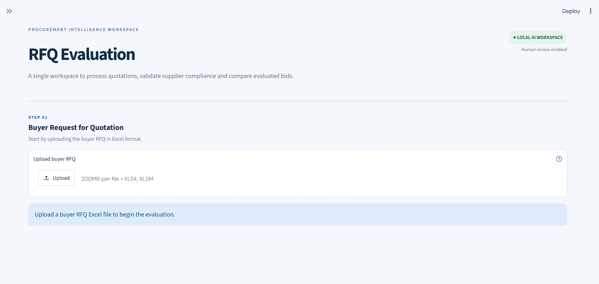

### 2. Buyer RFQ Upload
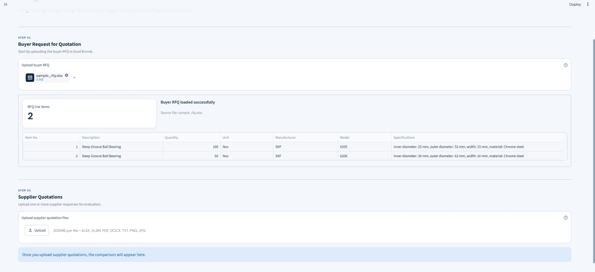

### 3. Supplier Quotation Upload
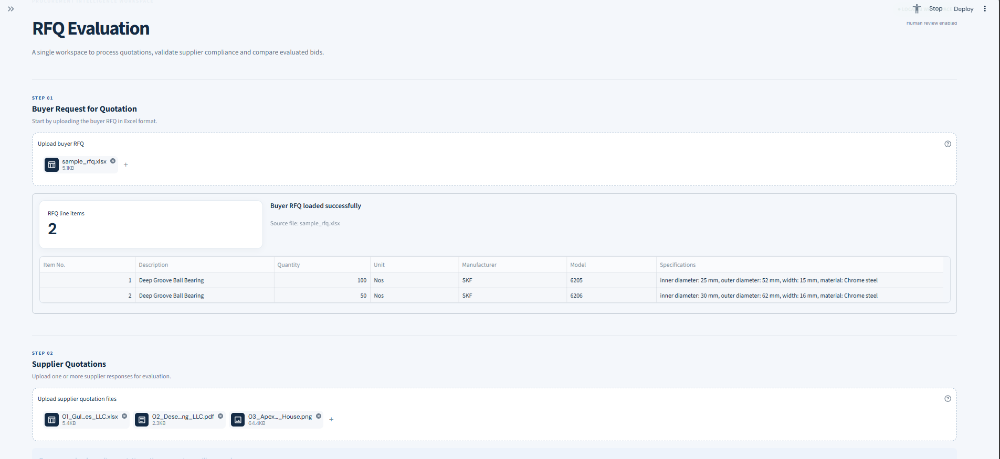

### 4. Evaluation Overview
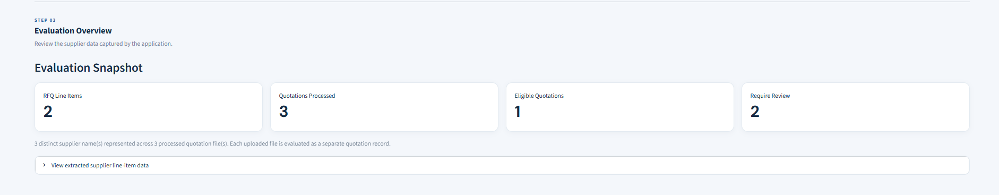

### 5. Extracted Supplier Data
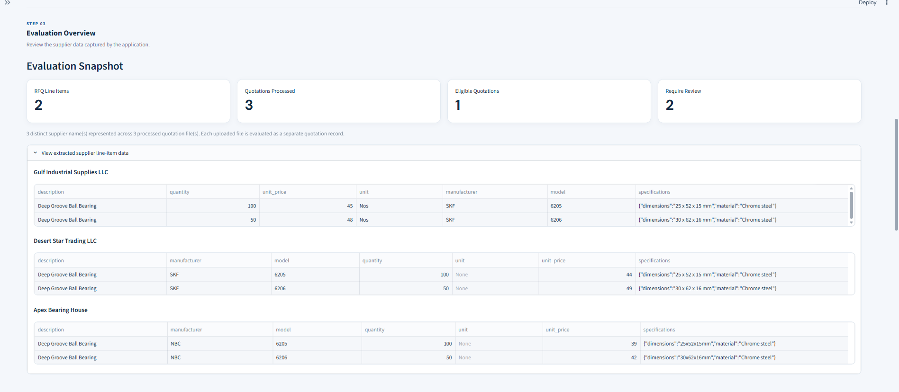

### 6. Supplier Comparison
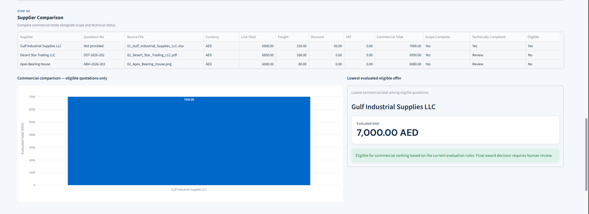

### 7. Technical Evaluation – Compliant
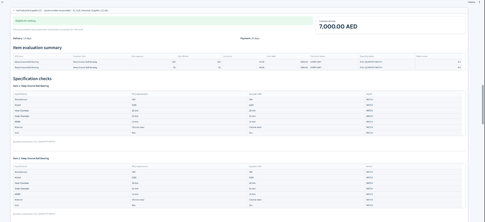

### 8. Technical Evaluation – Clarification Required
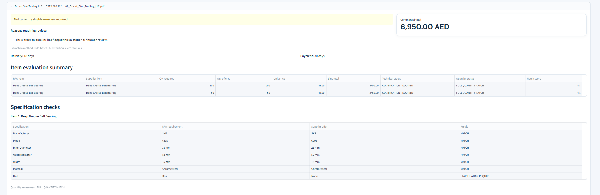

### 9. Technical Evaluation – Mismatch
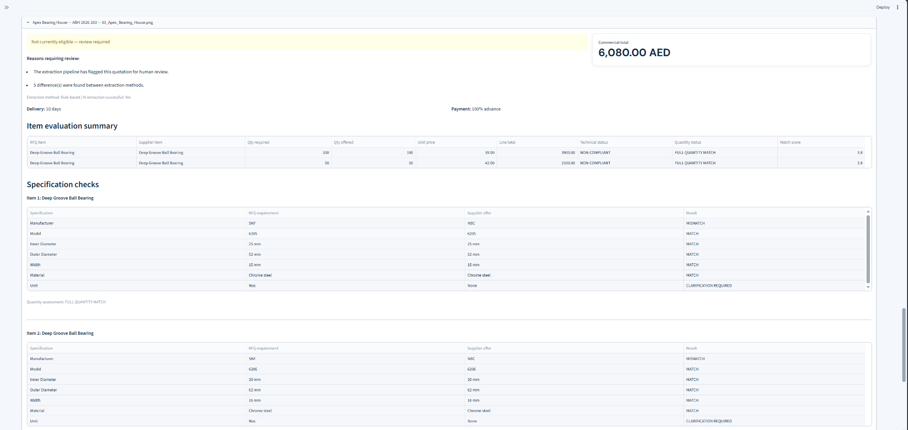

### 10. Human Review and Verification
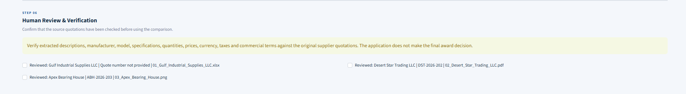

### 11. Excel Report Export
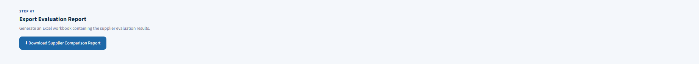
